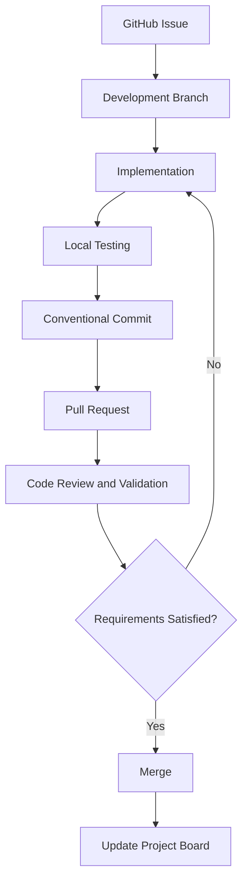

# Contributing to StudySphere

Thank you for your interest in contributing to StudySphere.

This document defines the development workflow, coding standards,
testing requirements, security expectations, and contribution
guidelines for StudySphere v2.0.

The project follows an issue-driven development approach supported
by GitHub Projects, Git, pull requests, automated testing, and
progressively implemented CI/CD practices.

---

## 1. Getting Started

### Prerequisites

- Git
- Node.js
- npm
- MongoDB Atlas account
- Cloudinary account
- A suitable code editor, such as Visual Studio Code

Additional tools will be introduced as the project evolves,
including Docker, Playwright, and cloud development tools.

### Clone the Repository

```bash
git clone https://github.com/2ndjoy/studysphere-.git
cd studysphere-
```

### Install Dependencies

Backend:

```bash
cd server
npm ci
```

Frontend:

```bash
cd ../client
npm ci
```

Return to the project root:

```bash
cd ..
```

Configure the local environment using the provided `.env.example`
files and follow the setup instructions in README.md.

Never commit actual environment credentials.

---

## 2. Project Management

StudySphere uses GitHub Projects to manage development activities.

Project board:

[StudySphere v2.0 - Development & DevOps](https://github.com/users/2ndjoy/projects/3)

### Kanban Workflow

| Status | Description |
|---|---|
| Backlog | Identified work awaiting prioritization |
| Ready | Defined and ready for implementation |
| In Progress | Implementation underway |
| In Review | Changes awaiting review and validation |
| Done | Acceptance criteria satisfied and changes integrated |

### Priority Levels

| Priority | Description |
|---|---|
| P0 | Critical security or application issues |
| P1 | High-priority development tasks |
| P2 | Medium-priority improvements |
| P3 | Low-priority enhancements |

Each development task should have:

- A GitHub issue
- A clear description
- Defined implementation tasks
- Measurable acceptance criteria
- An appropriate priority
- An assignee
- A milestone where applicable

---

## 3. Development Workflow

The standard development workflow is:

1. Create or select a GitHub issue.
2. Review its requirements and acceptance criteria.
3. Move the issue to In Progress.
4. Create a dedicated development branch.
5. Implement the required changes.
6. Perform relevant testing.
7. Review the changes locally.
8. Create meaningful Git commits.
9. Push the development branch.
10. Open a pull request linked to the issue.
11. Perform code review and validation.
12. Resolve review findings.
13. Merge the approved changes.
14. Update the project board and related issues.

### Workflow Diagram



---

## 4. Branching Strategy

The main branch represents the primary integrated version of
StudySphere.

New development should normally start from an up-to-date main branch.

```bash
git switch main
git pull --ff-only origin main
```

Create a dedicated branch for the assigned issue.

### Branch Naming Conventions

| Prefix | Purpose |
|---|---|
| feature/ | New application functionality |
| fix/ | Bug fixes |
| security/ | Security improvements |
| chore/ | Repository maintenance and configuration |
| refactor/ | Code restructuring |
| test/ | Automated testing |
| ci/ | Continuous integration and deployment |
| devops/ | Infrastructure and operational improvements |
| docs/ | Documentation |
| perf/ | Performance improvements |

### Naming Format

```text
<type>/<issue-number>-<short-description>
```

### Examples

```text
security/1-environment-configuration
chore/2-github-development-workflows
fix/8-assignment-status-update
test/5-automated-testing
ci/6-github-actions
```

### Stacked Branches

A development branch may depend on another unmerged branch
when necessary.

In such cases:

- Document the branch dependency.
- Preserve the intended commit history.
- Review changes against the appropriate parent branch.
- Merge dependencies in the correct order.
- Avoid including unrelated changes in pull requests.

Do not force-push or rewrite shared branch history without
appropriate coordination.

---

## 5. Commit Message Standards

StudySphere follows the Conventional Commits convention.

### Format

```text
<type>(optional-scope): <description>
```

### Commit Types

| Type | Purpose |
|---|---|
| feat | Introduce a new feature |
| fix | Resolve a bug |
| docs | Update documentation |
| style | Formatting-only changes |
| refactor | Restructure existing code |
| perf | Improve performance |
| test | Add or update tests |
| build | Modify build configuration |
| ci | Update CI/CD configuration |
| chore | General repository maintenance |
| revert | Revert an existing change |

### Examples

```text
feat: add assignment reminders
fix: resolve assignment status updates
fix(auth): enforce resource ownership
docs: update local development instructions
test: add assignment authorization tests
ci: configure GitHub Actions validation
chore: configure repository development workflows
```

### Reference Related Issues

```bash
git commit -m "fix: resolve assignment status updates" -m "Refs #8"
```

Commits should be focused, meaningful, and limited to their
intended development scope.

---

## 6. Coding Standards

### General Standards

- Write readable and maintainable code.
- Use meaningful variable and function names.
- Avoid unnecessary duplication.
- Keep functions focused on specific responsibilities.
- Remove unused imports and debugging statements.
- Handle errors appropriately.
- Follow the existing project structure.
- Avoid unrelated changes in the same pull request.

### Frontend Standards

- Use reusable React components.
- Follow consistent component naming.
- Provide accessible labels for interactive elements.
- Maintain responsive layouts.
- Preserve light and dark mode compatibility.
- Handle loading, success, and error states.
- Avoid exposing sensitive information in frontend code.

### Backend Standards

- Maintain separation between routes, controllers, models,
  middleware, and configuration.
- Validate incoming request data.
- Authenticate protected API requests.
- Enforce resource ownership and authorization.
- Return appropriate HTTP status codes.
- Never expose credentials or password hashes.
- Maintain consistent API response structures.
- Avoid disclosing internal implementation details in errors.

### Formatting and Linting

ESLint and Prettier will be standardized through dedicated
development issues.

Once implemented, contributors must run the applicable linting
and formatting checks before submitting pull requests.

---

## 7. Testing Requirements

Every change should be validated before submission.

### Manual Testing

Manual testing should cover:

- Relevant application functionality
- Expected success scenarios
- Error scenarios
- Regression testing
- Responsive behavior where applicable
- Data persistence
- Authentication and authorization impacts

### Frontend Build Validation

```bash
cd client
npm run build
```

### Backend Syntax Validation

Run applicable checks from the project root.

```bash
node --check server/app.js
```

### API Testing

API testing should cover:

- Successful requests
- Invalid request data
- Missing authentication
- Invalid authentication
- Unauthorized resource access
- Nonexistent resources
- Expected response structures

Postman may be used for exploratory and manual API testing.

Automated authorization tests must be added for security-sensitive
functionality.

### Automated Testing

StudySphere uses Vitest and React Testing Library
for frontend testing, and Node.js Test Runner with
Supertest for backend integration testing.

Before submitting a pull request, execute the applicable
automated tests from the repository root.

Frontend:

```bash
npm --prefix client test
```

Backend:

```bash
npm --prefix server test
```

Frontend coverage:

```bash
npm --prefix client run test:coverage
```

Backend coverage:

```bash
npm --prefix server run test:coverage
```

Frontend tests are located alongside application components
and use shared initialization in client/src/test/setup.js.

Backend integration tests are located in server/tests.

Shared backend test fixtures and database lifecycle
utilities are located in server/tests/helpers.

Backend tests use an isolated MongoDB Memory Server
instance instead of the existing MongoDB Atlas database.

### Automated Testing Standards

- Write meaningful tests for new functionality.
- Add regression tests when fixing bugs.
- Test successful and unsuccessful operations.
- Verify authorization and resource ownership.
- Verify database integrity where applicable.
- Keep test cases independent.
- Use synthetic test data.
- Clean up temporary test records.
- Mock external services where appropriate.
- Never use production credentials or production data.
- Never commit generated coverage reports.
- Never describe unexecuted tests as passing.

### Future Testing Improvements

- Expanded frontend and backend coverage.
- Playwright end-to-end testing.
- GitHub Actions and CircleCI test execution.
- Automated security regression testing.
- Post-deployment smoke testing.
- Progressive coverage enforcement.

## 8. Pull Request Guidelines

All significant changes should be submitted through a pull request.

Use the repository pull request template.

A pull request should include:

- A clear summary
- Related GitHub issues
- Implementation details
- Testing results
- Relevant screenshots or evidence
- Security considerations
- Deployment considerations
- A rollback plan where applicable
- Known limitations and outstanding work

### Linking Issues

Use:

```text
Closes #123
```

Only when the pull request satisfies the issue's remaining
acceptance criteria.

Use:

```text
Refs #123
```

When the pull request contains partial implementation or
related work.

### Author Self-Review

Before requesting review, the author should:

- Review the complete pull request diff.
- Verify the intended implementation scope.
- Confirm applicable tests pass.
- Check for accidental credential exposure.
- Remove unnecessary files.
- Document known limitations.
- Confirm that existing functionality remains operational.

---

## 9. Code Review and Merge Policy

StudySphere uses CODEOWNERS to define repository ownership.

Code review should assess:

- Functional correctness
- Code quality
- Maintainability
- Security
- Testing coverage
- Performance implications
- Documentation accuracy

### Individual Development

While StudySphere is maintained by a single developer,
documented author self-review will be used.

Author self-review does not constitute formal independent
GitHub pull request approval.

Independent reviews should be introduced when additional
contributors become available.

### Branch Protection

The target branch protection policy includes:

- Pull requests before merging into main
- Required CI status checks
- Successful build validation
- Applicable automated tests
- Resolved review conversations
- Protection against unauthorized force pushes
- Protection against accidental branch deletion

These controls will be configured once the required CI checks
are operational.

Do not enable approval requirements that cannot be satisfied
by the current contributor structure.

---

## 10. Security Guidelines

Security is a continuous responsibility throughout development.

### Credentials and Environment Variables

Never commit:

- Actual .env files
- API keys
- JWT secrets
- Database credentials
- Cloud access credentials
- Private certificates
- Authentication tokens

Use environment templates containing placeholders only.

Previously exposed credentials should be revoked or rotated.
Removing a secret from the latest version of a repository does
not remove it from Git history.

### Dependency Security

Run dependency audits separately within client and server.

```bash
npm audit
npm audit --omit=dev
```

Review security findings before applying dependency upgrades.

Do not apply forced dependency upgrades without evaluating
compatibility and performing regression testing.

### Vulnerability Reporting

Do not publicly disclose exploitable vulnerabilities, credentials,
or sensitive security findings.

Use a verified private reporting mechanism when one is available.

A dedicated security policy and private vulnerability reporting
process will be established as part of ongoing security improvements.

### Security Automation

Planned security controls include:

- Dependabot
- Gitleaks
- CodeQL
- Container vulnerability scanning
- Cloud secret management
- Automated security checks

---

## 11. Repository Hygiene

Do not commit generated files or installed dependencies.

Examples include:

```text
node_modules/
dist/
build/
coverage/
playwright-report/
test-results/
*.log
.env
```

Maintain frontend and backend package-lock.json files to
support reproducible dependency installations.

Use explicit staging when practical.

```bash
git status
git diff --stat
git add <intended-files>
git diff --cached --stat
```

Avoid displaying sensitive file contents in terminal logs,
screenshots, or pull request descriptions.

---

## 12. CI/CD and Cloud Development

StudySphere is progressively adopting automated delivery
and cloud engineering practices.

Planned technologies include:

- GitHub Actions
- CircleCI
- Docker
- Docker Compose
- Microsoft Azure
- Azure Container Registry
- Infrastructure as Code
- Application monitoring
- Automated deployment validation

Infrastructure and deployment changes should:

- Be version-controlled.
- Use secure configuration.
- Follow the principle of least privilege.
- Include appropriate validation.
- Consider rollback and recovery.
- Consider infrastructure costs.
- Avoid unnecessary production disruption.

---

## 13. Documentation Standards

Documentation should be updated whenever changes affect:

- Application functionality
- Installation instructions
- Environment configuration
- API endpoints
- Testing procedures
- Deployment processes
- Infrastructure architecture
- Security practices

Documentation must accurately distinguish implemented
functionality from planned improvements.

---

## 14. Definition of Done

A development issue is considered complete when:

- All applicable acceptance criteria are satisfied.
- The intended implementation is completed.
- Relevant tests have passed.
- Applicable build and validation checks have passed.
- Security considerations have been reviewed.
- Documentation has been updated where necessary.
- The pull request has been reviewed.
- Changes have been integrated into the intended branch.
- Outstanding risks and limitations have been resolved or
  explicitly tracked in follow-up issues.
- The GitHub issue and project board have been updated.

A local implementation or commit alone does not constitute
a completed production release.

---

## 15. Maintainer

Rahul Chakrabarty Joy

GitHub: [@2ndjoy](https://github.com/2ndjoy)

---

Thank you for contributing to StudySphere.

Organize smarter. Study better. Build continuously.