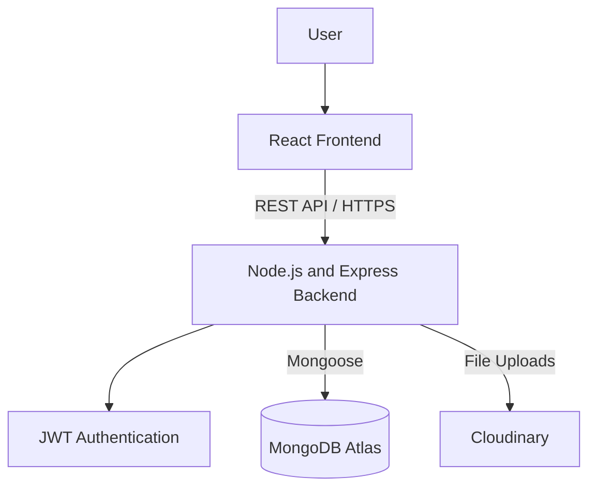
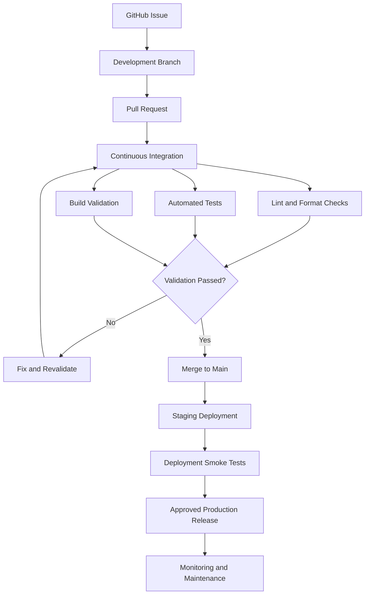

# 🚀 StudySphere

### Smart Student Workspace & Resource Hub

StudySphere is a full-stack student productivity platform built with the MERN stack. It helps students organize study materials, manage assignments, create notes, track academic progress, and manage academic resources through a modern and responsive dashboard.

StudySphere is currently evolving into a cloud-ready application with professional software engineering practices, automated testing, CI/CD pipelines, containerization, cloud deployment, and security monitoring.


---

## 📖 Table of Contents

- [Features](#-features)
- [Technology Stack](#-technology-stack)
- [Application Architecture](#-application-architecture)
- [Getting Started](#-getting-started)
- [Environment Variables](#-environment-variables)
- [Run the Application](#-run-the-application)
- [Available Commands](#-available-commands)
- [Project Structure](#-project-structure)
- [Project Management](#-project-management)
- [Development Workflow](#-development-workflow)
- [Security](#-security)
- [Deployment](#-deployment)
- [Development Roadmap](#-development-roadmap)
- [Author](#-author)

---

## ✨ Features

### Authentication and User Management

- User registration and login
- JWT-based authentication
- Protected application routes
- User profile management
- Profile picture uploads

### Academic Management

- Subject creation and management
- Assignment tracking
- Assignment priority management
- Assignment completion tracking
- Assignment search and filters
- Academic calendar

### Notes and Resources

- Rich-text note creation
- Note management
- Academic resource uploads
- Cloudinary-based file storage
- Resource management

### Dashboard and User Interface

- Academic dashboard
- Assignment statistics and visualization
- Responsive layout
- Dark and light mode
- Notification center foundation
- Modern animations and transitions

---

## ⚙️ Technology Stack

### Frontend

| Technology | Purpose |
|---|---|
| React.js | User interface development |
| Vite | Frontend development and build tooling |
| Tailwind CSS | Styling and responsive design |
| Framer Motion | Animations and transitions |
| React Router | Client-side routing |
| Axios | HTTP API communication |
| Recharts | Dashboard charts and visualizations |
| Tiptap | Rich-text editing |
| React Hot Toast | User feedback notifications |

### Backend

| Technology | Purpose |
|---|---|
| Node.js | JavaScript runtime |
| Express.js | REST API framework |
| Mongoose | MongoDB object data modeling |
| JSON Web Token | Authentication |
| bcryptjs | Password hashing |
| Multer | File upload handling |
| dotenv | Environment configuration |

### Database and Storage

| Technology | Purpose |
|---|---|
| MongoDB Atlas | Cloud-hosted NoSQL database |
| Cloudinary | Cloud-based file and image storage |

### Deployment Platforms

| Platform | Purpose |
|---|---|
| Vercel | Frontend deployment |
| Render | Backend deployment |

### Engineering and DevOps

| Technology | Status |
|---|---|
| Git and GitHub | In use |
| GitHub Projects | Configured |
| GitHub Issues | In use |
| GitHub Pull Requests | Planned workflow |
| ESLint | Standardization planned |
| Prettier | Planned |
| Vitest | Planned |
| React Testing Library | Planned |
| Supertest | Planned |
| Playwright | Planned |
| Docker | Planned |
| Docker Compose | Planned |
| GitHub Actions | CI pipeline planned |
| CircleCI | Planned |
| Microsoft Azure | Planned |
| Amazon Web Services | Planned experiments |
| Terraform / Bicep | Planned |
| Gitleaks | Planned |
| Trivy | Planned |
| Dependabot | Planned |

---

## 🏗️ Application Architecture

StudySphere follows a client-server architecture with a separate
frontend, backend, cloud database, and file storage service.



### Architecture Overview

- The React frontend provides the user interface.
- The Express backend exposes REST API endpoints.
- JWT authentication protects authenticated routes.
- MongoDB Atlas stores application data.
- Cloudinary manages uploaded files and images.
- Environment variables manage service configurations.

The architecture will be progressively enhanced with containerization,
automated deployment, monitoring, and cloud infrastructure.

---

## 🚀 Getting Started

### Prerequisites

Before running StudySphere locally, ensure that you have:

- Node.js
- npm
- Git
- A MongoDB Atlas account
- A Cloudinary account

Verify your local development environment:

```bash
node --version
npm --version
git --version
```

### 1. Clone the Repository

```bash
git clone https://github.com/2ndjoy/studysphere-.git
cd studysphere-
```

### 2. Install Backend Dependencies

From the project root:

```bash
cd server
npm ci
```

### 3. Install Frontend Dependencies

From the server directory:

```bash
cd ../client
npm ci
```

Return to the project root:

```bash
cd ..
```

StudySphere maintains separate dependency lock files for the frontend
and backend.

Using `npm ci` ensures reproducible dependency installations and
supports consistent development, testing, and future CI/CD builds.

---

## 🔑 Environment Variables

The application requires separate environment configuration files
for the frontend and backend.

Environment templates are provided:

```text
server/.env.example
client/.env.example
```

Create a local `.env` file in each directory using its corresponding
template.

### Windows Command Prompt

Run these commands from the project root if the local `.env` files
do not already exist:

```cmd
copy server\.env.example server\.env
copy client\.env.example client\.env
```

### Linux / macOS

```bash
cp server/.env.example server/.env
cp client/.env.example client/.env
```

Do not overwrite existing environment files containing your local
configuration.

### Backend Configuration

File: `server/.env`

```env
MONGO_URI=mongodb+srv://<username>:<password>@<cluster-url>/<database-name>

JWT_SECRET=your_secure_jwt_secret

CLOUDINARY_CLOUD_NAME=your_cloud_name
CLOUDINARY_API_KEY=your_api_key
CLOUDINARY_API_SECRET=your_api_secret
```

Replace the placeholder values with your own credentials.

| Variable | Description |
|---|---|
| `MONGO_URI` | MongoDB Atlas database connection string |
| `JWT_SECRET` | Secret used to sign and verify JWT tokens |
| `CLOUDINARY_CLOUD_NAME` | Cloudinary cloud name |
| `CLOUDINARY_API_KEY` | Cloudinary API key |
| `CLOUDINARY_API_SECRET` | Cloudinary API secret |

Ensure that your MongoDB Atlas network access configuration allows
connections from your development environment.

### Frontend Configuration

File: `client/.env`

```env
VITE_API_URL=http://localhost:5000/api
```

| Variable | Description |
|---|---|
| `VITE_API_URL` | Backend API base URL |

For production deployment, configure this variable with the deployed
backend API URL.

> Never store private credentials in frontend environment variables.
> Variables prefixed with `VITE_` can be exposed in the browser.

---

## ▶️ Run the Application

Open two separate terminals from the project root.

### Terminal 1 — Start Backend

```bash
cd server
npm run dev
```

The backend connects to MongoDB Atlas before starting the HTTP server.

Expected startup output:

```text
MongoDB Connected
Serverr running on port 5000
```

### Terminal 2 — Start Frontend

```bash
cd client
npm run dev
```

Open the frontend URL in your browser.

### Local Services

| Service | URL |
|---|---|
| Frontend | http://localhost:5173 (or 5174/5175) |
| Backend API | http://localhost:5000/api |

Both services must be running for the complete application to work.

---

## 💻 Available Commands

### Frontend

Run from the `client` directory:

```bash
npm ci
npm run dev
npm run build
npm run preview
npm audit
npm audit --omit=dev
```

| Command | Description |
|---|---|
| `npm ci` | Install dependencies from the lock file |
| `npm run dev` | Start the development server |
| `npm run build` | Generate a production build |
| `npm run preview` | Preview the production build locally |
| `npm audit` | Audit all dependencies |
| `npm audit --omit=dev` | Audit non-development dependencies |

### Backend

Run from the `server` directory:

```bash
npm ci
npm run dev
npm audit
npm audit --omit=dev
```

| Command | Description |
|---|---|
| `npm ci` | Install dependencies from the lock file |
| `npm run dev` | Start the backend using Nodemon |
| `npm audit` | Audit all dependencies |
| `npm audit --omit=dev` | Audit production dependencies |

Additional linting, formatting, testing, and container commands
will be documented after their implementation.

---
## Automated Testing

StudySphere uses automated frontend and backend testing
to improve application reliability, maintainability,
and regression prevention.

### Testing Technologies

| Technology | Purpose |
|---|---|
| Vitest | Frontend test execution |
| React Testing Library | React component testing |
| Jest DOM | DOM assertions |
| User Event | Simulated user interactions |
| jsdom | Simulated browser environment |
| V8 Coverage | Frontend code coverage |
| Node.js Test Runner | Backend test execution |
| Node.js Assert | Backend assertions |
| Supertest | HTTP API integration testing |
| MongoDB Memory Server | Isolated database testing |

### Running Automated Tests

Install the frontend and backend dependencies from
the project root:

```bash
npm --prefix client ci
npm --prefix server ci
```

Run frontend tests:

```bash
npm --prefix client test
```

Run backend tests:

```bash
npm --prefix server test
```

Run frontend tests in watch mode:

```bash
npm --prefix client run test:watch
```

### Code Coverage

Generate frontend coverage:

```bash
npm --prefix client run test:coverage
```

The frontend HTML coverage report is available at:

`client/coverage/index.html`

LCOV coverage data is available at:

`client/coverage/lcov.info`

Generate backend coverage:

```bash
npm --prefix server run test:coverage
```

Backend coverage results are displayed in the terminal.

### Current Automated Test Baseline

Baseline established on 21 November 2026.

| Test Suite | Tests | Passed |
|---|---:|---:|
| AssignmentCard component | 12 | 12 |
| Backend smoke tests | 5 | 5 |
| Authentication API | 11 | 11 |
| Assignment API | 12 | 12 |
| Subject API | 7 | 7 |
| Total | 47 | 47 |

All 47 automated tests passed locally.

### Frontend Coverage Baseline

| Metric | Overall Frontend | AssignmentCard |
|---|---:|---:|
| Statements | 1.76% | 100% |
| Branches | 12.20% | 100% |
| Functions | 1.59% | 100% |
| Lines | 1.78% | 100% |

Frontend coverage currently focuses on AssignmentCard
regression testing. Additional components, pages,
contexts, hooks, and services will be tested progressively.

### Backend Coverage Baseline

| Metric | Reported Coverage |
|---|---:|
| Lines | 68.35% |
| Branches | 81.43% |
| Functions | 46.15% |

| Module | Lines | Branches | Functions |
|---|---:|---:|---:|
| Authentication middleware | 100% | 100% | 100% |
| Authentication controller | 91.01% | 81.82% | 100% |
| Assignment controller | 80.98% | 61.90% | 100% |
| Subject controller | 78.57% | 70.00% | 100% |

Backend coverage reflects modules loaded during testing.
High code coverage does not guarantee complete functional
or security validation.

### Test Database Isolation

Backend integration tests use MongoDB Memory Server
with MongoDB version 8.2.6.

The automated tests:

- Start a temporary local MongoDB instance.
- Bind the test database to 127.0.0.1.
- Use the studysphere_test database.
- Generate synthetic test users and records.
- Generate a temporary JWT signing secret.
- Use placeholder Cloudinary configuration.
- Do not require existing MongoDB Atlas credentials.
- Remove test records between test cases.
- Disconnect and stop the temporary database after testing.

The first execution may download a MongoDB executable.
Subsequent executions normally reuse the cached executable.

Neither the live frontend nor the normal backend server
needs to be running for these automated tests.

### Security Regression Testing

The current test suite verifies:

- Password hashing with bcrypt.
- Duplicate email rejection.
- Invalid login credential rejection.
- JWT authentication.
- Missing, invalid, expired, and incorrectly signed tokens.
- Assignment and subject ownership restrictions.
- Cross-user retrieval isolation.
- Unauthorized status update prevention.
- Unauthorized deletion prevention.
- Database integrity following unauthorized requests.
- Assignment status persistence.
- PATCH CORS preflight configuration.

Known outstanding security vulnerabilities are tracked
separately and will receive additional regression tests.

### Planned Testing Improvements

- Additional frontend component tests.
- Authentication UI tests.
- API input validation tests.
- Password hash exposure regression tests.
- Cross-user subject reference validation.
- Note API integration tests.
- Notification API integration tests.
- Resource API integration tests.
- User profile integration tests.
- Playwright end-to-end testing.
- GitHub Actions test automation.
- CircleCI test automation.
- Post-deployment validation.
- Progressive coverage thresholds.

Generated coverage reports are excluded from Git.

## 📁 Project Structure

```text
studysphere-/
│
├── client/
│   ├── public/
│   ├── src/
│   │   ├── components/
│   │   ├── context/
│   │   ├── layouts/
│   │   ├── pages/
│   │   ├── services/
│   │   └── main.jsx
│   │
│   ├── .env.example
│   ├── package.json
│   └── package-lock.json
│
├── server/
│   ├── config/
│   ├── controllers/
│   ├── middleware/
│   ├── models/
│   ├── routes/
│   ├── .env.example
│   ├── app.js
│   ├── server.js
│   ├── package.json
│   └── package-lock.json
│
├── .gitignore
└── README.md
```

### Backend Responsibilities

- `config/` — External service configuration
- `controllers/` — Application logic and request handling
- `middleware/` — Authentication and request processing
- `models/` — MongoDB schemas and data models
- `routes/` — REST API endpoints
- `app.js` — Express application configuration
- `server.js` — Database connection and server startup

### Frontend Responsibilities

- `components/` — Reusable UI components
- `context/` — Shared application state
- `layouts/` — Application layout components
- `pages/` — Application pages
- `services/` — Backend API communication

---

## 📋 Project Management

StudySphere v2.0 uses GitHub Projects and issue-based development
to organize improvements and track engineering tasks.

### GitHub Project

[StudySphere v2.0 — Development & DevOps](https://github.com/users/2ndjoy/projects/3)

### Kanban Workflow


| Status | Description |
|---|---|
| Backlog | Planned work |
| Ready | Prioritized and ready for development |
| In Progress | Active implementation |
| In Review | Pull request and validation |
| Done | Completed and accepted work |

### Priority Levels

| Priority | Description |
|---|---|
| P0 | Critical security or application issues |
| P1 | High-priority engineering improvements |
| P2 | Medium-priority enhancements |

Development tasks are tracked using GitHub Issues, milestones,
labels, priorities, and acceptance criteria.

---

## 🔄 Development Workflow

StudySphere is adopting an issue-driven GitHub development workflow.

The intended process for new changes is:

1. Create a GitHub issue.
2. Define tasks and acceptance criteria.
3. Assign priority and milestone.
4. Move the issue to In Progress.
5. Create a dedicated development branch.
6. Implement and test the changes.
7. Create meaningful Git commits.
8. Open a pull request linked to the issue.
9. Review changes and validate checks.
10. Merge approved changes into the main branch.
11. Update the project board.

### Branch Naming Convention

```text
feature/<issue-number>-description
fix/<issue-number>-description
security/<issue-number>-description
chore/<issue-number>-description
test/<issue-number>-description
ci/<issue-number>-description
devops/<issue-number>-description
docs/<issue-number>-description
```

Example:

```text
security/1-environment-configuration
```

### Commit Naming Convention

StudySphere aims to follow Conventional Commits.

```text
feat: introduce a new feature
fix: resolve an application bug
docs: update project documentation
chore: update repository configuration
test: add or update automated tests
ci: update CI/CD configuration
build: update build configuration
refactor: restructure existing code
perf: improve application performance
```

Example:

```bash
git commit -m "chore: improve environment configuration and repository hygiene"
```

### Planned CI/CD Workflow



This pipeline represents the target engineering workflow and will
be implemented progressively through the development roadmap.

---

## 🔒 Security

Security is an ongoing part of StudySphere development.

### Environment and Secret Management

- Real `.env` files must not be committed to Git.
- `.env.example` files must contain placeholders only.
- Private credentials must remain outside frontend code.
- Deployment credentials should be managed using secure platform
  environment configuration.
- Exposed credentials should be rotated.
- Historical secret exposure must be investigated and remediated.

### Repository Hygiene

The following files and directories are excluded from normal Git
tracking:

```text
.env
.env.*
node_modules/
dist/
build/
coverage/
playwright-report/
test-results/
*.log
```

Environment template files are explicitly permitted.

Dependency lock files are retained to support reproducible builds.

### Dependency Security Auditing

Run the following commands separately in the frontend and backend
directories:

```bash
npm audit
npm audit --omit=dev
```

Review dependency findings before applying upgrades.

Breaking dependency changes should be evaluated and tested through
dedicated issues and pull requests.

### Security Status

Repository hygiene improvements are underway as part of Sprint 1.

Dependency vulnerabilities, historical credential exposure,
authentication hardening, authorization improvements, and automated
security scanning are tracked as ongoing security work.

The application should not be considered production-hardened until
these risks have been addressed and validated.

### Planned Security Improvements

- Credential rotation and historical secret remediation
- Authentication and authorization hardening
- Input validation and sanitization
- Secure file upload handling
- Rate limiting
- HTTP security headers
- Dependabot security updates
- Gitleaks secret scanning
- CodeQL static analysis
- Trivy container vulnerability scanning
- Secure cloud secret management

---

## ☁️ Deployment

StudySphere has been configured for deployment using separate
frontend and backend hosting platforms.

### Existing Deployment Platforms

| Component | Platform |
|---|---|
| Frontend | Vercel |
| Backend | Render |
| Database | MongoDB Atlas |
| File storage | Cloudinary |

### Planned Cloud Deployment

Future development will focus on:

- Docker containerization
- Docker Compose development environments
- Container registries
- Automated GitHub Actions deployment
- CircleCI pipeline implementation
- Microsoft Azure application deployment
- Staging and production environments
- Infrastructure as Code
- Cloud networking and security
- Application monitoring and logging
- Scalability and availability
- Deployment rollback strategies
- Cloud cost optimization

---

## 🗺️ Development Roadmap

StudySphere v2.0 aims to demonstrate the complete software
development lifecycle, from application development to automated
cloud delivery and maintenance.

### Sprint 1 — Repository Foundation & Security

- [x] Preserve existing repository and commit history
- [x] Create GitHub Projects Kanban board
- [x] Establish GitHub Issues and milestones
- [x] Configure issue priorities and ownership
- [x] Establish initial development branch
- [x] Audit environment files and Git history
- [x] Configure local Git ignore rules
- [x] Remove tracked environment files from the working branch index
- [x] Remove tracked node_modules from the working branch index
- [x] Create environment configuration templates
- [x] Verify reproducible dependency installation
- [x] Complete baseline dependency vulnerability assessment
- [ ] Complete environment security remediation
- [ ] Rotate previously exposed credentials
- [ ] Configure issue and pull request templates
- [ ] Configure CODEOWNERS
- [ ] Improve authentication and authorization
- [ ] Configure ESLint and Prettier
- [ ] Establish automated testing
- [ ] Implement GitHub Actions CI
- [ ] Remediate vulnerable dependencies
- [ ] Configure branch protection and required checks

### Sprint 2 — Docker & End-to-End Testing

- [ ] Create frontend Dockerfile
- [ ] Create backend Dockerfile
- [ ] Implement multi-stage Docker builds
- [ ] Configure Docker Compose
- [ ] Configure container health checks
- [ ] Configure Playwright
- [ ] Implement automated end-to-end tests
- [ ] Integrate Docker builds into CI
- [ ] Publish test reports and build artifacts

### Sprint 3 — CI/CD & Automated Deployment

- [ ] Extend GitHub Actions workflows
- [ ] Implement CircleCI pipelines
- [ ] Configure container registry
- [ ] Automate staging deployment
- [ ] Configure production deployment
- [ ] Implement deployment approval workflows
- [ ] Implement post-deployment smoke tests
- [ ] Implement rollback strategies
- [ ] Establish semantic versioning and releases

### Sprint 4 — Cloud Infrastructure & Scalability

- [ ] Microsoft Azure deployment
- [ ] Azure Container Registry integration
- [ ] Cloud networking configuration
- [ ] Infrastructure as Code
- [ ] Horizontal and vertical scaling
- [ ] Load balancing
- [ ] High availability evaluation
- [ ] AWS deployment experiments
- [ ] Cloud architecture documentation

### Sprint 5 — Monitoring, Reliability & DevSecOps

- [ ] Structured application logging
- [ ] Application health endpoints
- [ ] Azure Monitor integration
- [ ] Application Insights integration
- [ ] Monitoring dashboards and alerts
- [ ] Automated secret scanning
- [ ] Dependency security scanning
- [ ] Container vulnerability scanning
- [ ] Database backup and recovery strategy
- [ ] Cloud cost monitoring

### Sprint 6 — Application Features & User Experience

- [ ] Complete automatic notification system
- [ ] Real-time notification updates
- [ ] Account settings
- [ ] Email verification
- [ ] Password recovery
- [ ] Enhanced rich-text notes
- [ ] PDF and resource previews
- [ ] Global search
- [ ] Advanced dashboard analytics
- [ ] Study groups
- [ ] Discussion threads
- [ ] Real-time collaboration
- [ ] Academic reminders
- [ ] Improved calendar functionality
- [ ] Drag-and-drop task management
- [ ] Progressive Web App support
- [ ] Offline functionality

### Sprint 7 — Performance & Portfolio Presentation

- [ ] Frontend performance optimization
- [ ] Backend performance optimization
- [ ] Database query optimization
- [ ] Load and performance testing
- [ ] Accessibility improvements
- [ ] Complete API documentation
- [ ] Final architecture diagrams
- [ ] CI/CD documentation
- [ ] Cloud deployment documentation
- [ ] Application screenshots
- [ ] Live demonstration
- [ ] Portfolio case study

### Future Exploration

- AI-powered study summaries
- AI study assistant
- Personalized learning recommendations
- Cloud cost anomaly detection

---

## 🎯 Project Objectives

StudySphere is designed to demonstrate practical experience in:

- Full-stack software development
- REST API design
- Database management
- Cloud application development
- Agile and Kanban project management
- Git and GitHub development workflows
- Automated software testing
- Continuous Integration and Continuous Deployment
- Docker and containerization
- Cloud infrastructure
- DevSecOps
- Application reliability and monitoring

---

## 👨‍💻 Author

**Rahul Chakrabarty Joy**

Master of Information Technology  
Auckland Institute of Studies, New Zealand

Interested in Full-Stack Software Development, Cloud Engineering,
DevOps, and modern software engineering practices.

GitHub: [2ndjoy](https://github.com/2ndjoy)

---

## ⭐ Support

If you find this project interesting, consider giving it a star
on GitHub.

Feedback, suggestions, and improvement ideas are welcome through
GitHub Issues.

---

**StudySphere — Organize smarter. Study better. Build continuously.**